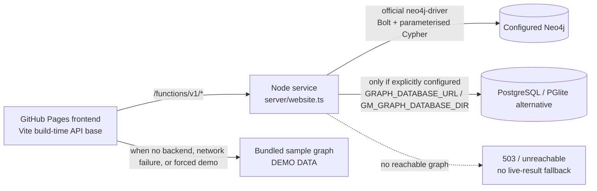

# GraphMentor AI architecture and deployment truth

**Status as of 2026-10-17:** the code supports live Neo4j and an explicitly configured PostgreSQL graph-reader alternative. The verification tooling that can prove either one is in place (`node scripts/verify-neo4j.mjs`, and the `Verify Neo4j (live)` workflow that runs it with the repository's server-side credentials). This repository checkout does not prove that any external Render service, Neo4j instance, GitHub Pages build variable, or public-site request is configured. Treat production connectivity as **unverified until the HTTP verification script returns PASS against the deployed backend**.

## Production live architecture (deployment not verified)

The intended production live path is GitHub Pages → Node API → Neo4j, but no live external service or public-site request is verified from this checkout. When that path is configured and verified, use the evidence gates below before calling it the production architecture. The supported PostgreSQL and bundled demo paths are alternatives, not evidence of Neo4j production connectivity.

## Request paths



The React client normally calls the shared `/functions/v1/*` API contract. On the Node service, `server/website.ts` routes those paths to `server/graphApi.ts`, which passes the configured reader into the shared handlers. The Neo4j reader in `server/neo4jDriverReader.ts` uses the official `neo4j-driver`, read-only sessions, bounded timeouts, parameterized Cypher, and closes each query session. The long-lived driver is closed on shutdown. API response `meta.source` is selected from the reader actually used; the dedicated `/api/query` allow-list reports `servedBy: neo4j-live` only after its driver query succeeds.

### Runtime source states

- **LIVE NEO4J:** only after a successful non-health API response includes valid `meta.source: "neo4j-live"` (or a successful named-query response includes `servedBy: "neo4j-live"`). A configured URL or health ping alone does not set this label.
- **DEMO DATA:** the frontend is using its bundled `src/data/seed/knowledgeGraph.ts` sample. Demo mode remains useful offline and is never mixed invisibly with a live response.
- **BACKEND UNAVAILABLE:** a configured backend could not be reached; bundled demo data is used, with both facts displayed.
- **NEO4J UNAVAILABLE:** the API responds but says its graph reader is unreachable. Live endpoints return errors; they do not silently substitute bundled JSON.
- **LIVE POSTGRESQL:** supported as an alternative when Neo4j is not configured and a PostgreSQL/PGlite graph store is explicitly configured. It is never called Neo4j.

## Backend deployment

`render.yaml` describes one Render Node web service. It runs `npm ci --include=dev && npm run build`, then `npm start`; the server binds `0.0.0.0:$PORT`, serves `/api/health`, `/api/health/neo4j`, `/api/graph/stats`, `/api/query` and the `/functions/v1/*` routes, and supports CORS preflight using `ALLOWED_ORIGINS`.

Configure server-side Render environment variables:

- `NEO4J_URI` — Bolt URI such as `neo4j+s://...databases.neo4j.io`
- `NEO4J_USERNAME`
- `NEO4J_PASSWORD` — secret; never expose to Vite or commit it
- `NEO4J_DATABASE` — normally `neo4j`
- `ALLOWED_ORIGINS` — include `https://authorsauravkushwaha.github.io` (origin only, no repository path)

The Neo4j credentials must be stored in the hosting dashboard, not in frontend variables. Render service creation and credentials are external actions and have not been verified from this repository. The backend can start without Neo4j; liveness remains distinct from graph readiness and graph endpoints report unavailable.

## GitHub Pages frontend configuration

The `.github/workflows/deploy.yml` computes and preserves the project Pages base path (`/Neo4j-Build-Sprint/`) and embeds the backend API base at build time.

That base has exactly one resolver, `scripts/resolve-api-base.ts`, and two possible sources:

1. `VITE_API_BASE_URL` — the repository Actions **variable** (public configuration, not a secret). It wins when it is set.
2. `config/production-backend.json` — the committed configuration. It is the fallback, and it makes a build reproducible from the repository alone: the URL that ends up in the published artifact is visible in a pull request instead of hidden in a settings page.

When both are set they must agree; a build that silently prefers one of them is how a site ends up pointing at a backend nobody is looking at. The rules the resolver enforces are the same rules the workflow checks with: an absolute `https://` URL in a production build, no credentials in it, no localhost, and the shared function contract `/functions/v1` at the end. The Node service genuinely serves that contract (`server/graphApi.ts` mounts every function route under `/functions/v1/`), so the suffix is not Supabase-specific.

One legitimate production shape is a same-origin API: one process serves the static site *and* `/functions/v1` (the Render Blueprint). In that case set `VITE_API_BASE_URL=/functions/v1` and `GM_ALLOW_SAME_ORIGIN_API_BASE=true`. The second variable is never `VITE_*` and never reaches the browser; without it a production build refuses a relative API base, because GitHub Pages cannot serve that contract. The Content-Security-Policy copies (the `<meta>` tag and `dist/_headers`) are generated from the same allow-list so a static host cannot ship a header that blocks the API the meta tag just allowed.

Never use a `VITE_*` variable for Neo4j credentials. Changing either source does not change an existing Pages artifact: run a new Pages build afterwards. If both are empty, the Pages workflow deliberately builds the demo-capable frontend, which labels itself DEMO DATA.

## Seed and data safety

`neo4j/seed.cypher` and `scripts/seed-neo4j.ts` are repeatable upserts: nodes are `MERGE`d by schema `id`, relationships by endpoints/type, and default generated writes set properties only on create. Reruns do not duplicate graph records or overwrite existing properties. `npm run seed:neo4j -- --update-existing` is an explicit operator action that updates seed-owned properties on matched records; review/authorize the target before using it. There is no database reset/delete in the Neo4j seed. The script posts generated, parameterized row payloads and verifies node counts. Separately, `npm run seed:graphdb -- --wipe` is destructive to the alternative PostgreSQL store and requires an explicit command; it is not part of normal deployment.

The seed script writes the same generated payload over two transports, so it can fill the database the backend actually reads: **Bolt** through the official `neo4j-driver` (when `NEO4J_URI` is set) and the **HTTPS Query API** (when `NEO4J_QUERY_URL` is set, which is what the Supabase Edge Functions read through). `npm run seed:neo4j -- --check` is read-only: it reports the identity of the configured database, what it already holds, and whether that matches the generated manifest, without writing anything. That is the step to run before seeding.

## Verification levels

| Capability | Implemented in code | Tested in this checkout | Verified in production |
| --- | --- | --- | --- |
| Official Neo4j driver, parameterized named queries, driver/session lifecycle | Yes | Unit/integration tests can exercise contracts | **Not established here** |
| Neo4j seed uses MERGE, no reset, over Bolt or the Query API | Yes | Generated seed validation | Not established here |
| Render backend blueprint and GitHub Pages API-base build input | Yes | Workflow/config checks | **Not established here** |
| Actual Neo4j query through deployed API | Verification script and the `Verify Neo4j (live)` workflow support it | Verifier verdicts are unit-tested against mock backends | **BLOCKED until the verifier returns PASS against a real instance** |
| Public Pages-to-backend request and live UI badge | Implemented based on response metadata | Frontend/API tests | **Not established here** |

The verifier's verdicts are pinned by unit tests against mock backends. Those tests prove the *verifier's* logic; they are not a live database verification, and the script never reports a mock as one — it only reports what the service actually returned.

## Useful commands

```bash
npm run typecheck
npm test
npm run build
npm run lint:secrets
npm run verify:api-config                    # the backend URL a build would embed
npm run seed:neo4j -- --check                # read-only: which database, and what it holds
npm run verify:neo4j                         # local backend defaults to http://127.0.0.1:3000
node scripts/verify-neo4j.mjs https://ACTUAL_BACKEND            # Node backend: the origin
node scripts/verify-neo4j.mjs https://ACTUAL.supabase.co/functions/v1   # Edge Functions
```

The verifier detects the contract from the target URL (a `/functions/v1` base is a Supabase deployment; anything else is the Node backend) and can be forced with `--kind=node|supabase`. For the Node backend, pass its origin (no `/functions/v1` suffix): `node scripts/verify-neo4j.mjs https://ACTUAL_BACKEND`. It requires liveness, Neo4j health, live graph statistics, a non-empty `career.longest-prereq-chain` query response, and proof that arbitrary Cypher and injected parameters are refused. Exit codes: `0` PASS, `1` FAIL, `2` BLOCKED.

The `Verify Neo4j (live)` workflow runs exactly that script inside GitHub Actions with the repository's server-side credentials, and publishes the verdict as a pull-request comment. It is the shortest path to evidence that a real Neo4j instance answered.

See [Neo4j verification](verification-neo4j.md), [deployment](deployment.md), [graph database options](graph-database.md), and [judge demo](demo-script-neo4j.md). These pages defer to this document for architecture facts.
